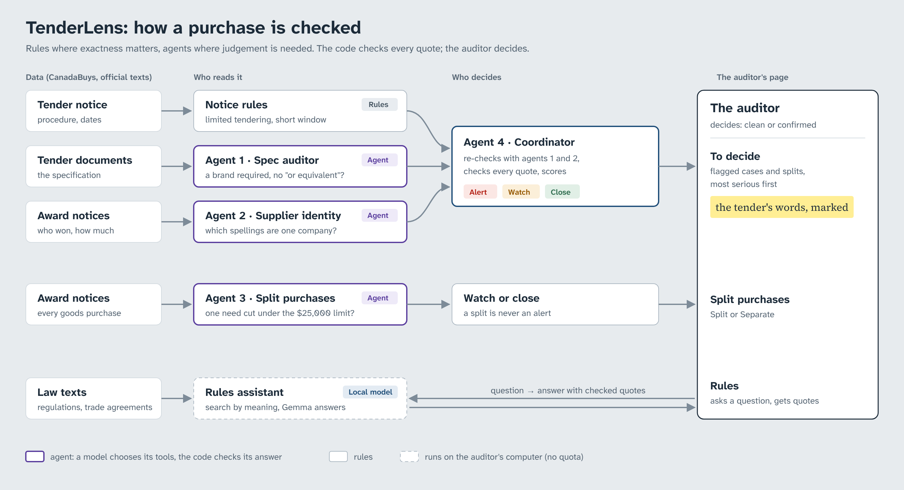

# TenderLens

Reads Canada's published procurement records (CanadaBuys: tender notices, tender documents, award notices) and helps a federal auditor answer one question per contract: **was the competition real, or staged?**

It is an assistant, not a judge: it **clears most purchases with quoted evidence** and builds a **case file for the few worth a look**, each reason tied to its rule of law. It never says "fraud"; a person decides.

Our six families of goods publish about 1,000 notices a year, about 5 readable tenders a week, and real signs of rigging are rare (2 brand lock-ins in a random sample of 102 tenders). Clearing quickly and showing why is the job.

---

## How it works

A **hybrid multi-agent system**: **rules where exactness matters** (what a notice declares, whether a quote is really in a document, scoring, routing), **agents where judgement is needed**, and every choice between the two measured. An agent is a model that chooses its own tools, step by step; the code checks what it may conclude.



**The four agents** (one presenter each):

| Agent | Reads | Decides | Doc |
|---|---|---|---|
| **1. Spec auditor** (M2) | the tender documents | is this name a brand the bidder must supply, with no "or equivalent"? Rules find the names and settle what the text decides exactly; the agent letters the rest a–f with a checked quote. Held-out: 34 of 35 right | [M2_spec_auditor.md](docs/agents/M2_spec_auditor.md) |
| **2. Supplier identity** (M3) | the award file | are these spellings of the winner one company? Who won, and does this buyer keep choosing them (context) | [M3_investigator.md](docs/agents/M3_investigator.md) |
| **3. Split-purchase agent** | the award file alone | are these contracts, each under the $25,000 limit for buying without bids, one need cut into pieces? | [split_agent.md](docs/agents/split_agent.md) |
| **4. Coordinator** (M4) | what M1–M3 found | sends each brand finding back to agent 1 and the winner's spellings to agent 2, in a fixed order; checks every quote; scores; alert / watch / close. A model choosing the checks was measured worse (2 false alarms vs 0) | [M4_case_builder.md](docs/agents/M4_case_builder.md) |

Around them: **M1** (rules) reads the notice: procedure, bidding window, trade agreement ([M1_screener.md](docs/agents/M1_screener.md)). The **rules assistant** answers the auditor's questions from the official law texts (RAG: hybrid search, keywords + local embeddings, then Gemma on a local model), with quotes checked word for word ([rules_agent.md](docs/agents/rules_agent.md)).

**Routing in one line:** only a brand found **in the documents** can raise an **alert**; what the buyer **declared** on the notice only ranks a case; award history and "no trade agreement" are **context** and never put a case in the queue. A **split purchase** reaches watch, never alert. Each reason links to its rule of law (`tools/laws.py`).

**Not audit cases:** an advance contract award notice (the supplier was announced and others could object), and anything cancelled, still open or not a purchase. In selective tendering (only pre-qualified suppliers bid), a short window is normal and doesn't count.

---

## Folder layout

```
tenderlens.py          the one command: serve, demo, tender, run, update, splits, ask, test, eval, awards, prepare, llm
pipeline/              one_tender.py (M1–M4 on one tender), stream.py (a family, tender by tender, against its
                       knowledge base), update.py (weekly), demo.py, settings.py (one run's choices)
agents/                m1_screener.py, m2_spec_auditor.py + m2_agent.py, m3_investigator.py + m3_agent.py,
                       m4_case_builder.py + m4_checks.py, split_agent.py, rules_agent.py,
                       agent_loop.py (the loop agents 1–3 share), evidence.py (what M2 and M3 hand to M4)
tools/                 documents.py, sections.py, brands.py (brand rules), wikidata.py, names.py (how names are
                       compared), llm.py (Groq), local_llm.py (Ollama: answers, embeddings), laws.py (the rules
                       of law), law_index.py (search over the law texts), level2.py (dormant), report.py
prepare/               data preparation: profile → docs → text → labels; laws (the official law texts)
interface/             the auditor's page (app.py, data.py, jobs.py, static/)
tests/                 offline tests (test_*.py), evaluations (m2_eval.py, m4_eval.py, synth_rig.py), labels
docs/agents/           one page per component; docs/DECISIONS.md (the numbered decisions the code cites);
                       docs/PLAN.md (what is done, what is left)
data/                  not in git: tenders.csv, awards.csv, documents, law pages
reports/               not in git: extracted text, knowledge bases, queues, caches, runs
```

Everything starts from `python tenderlens.py <command>` (`-h` for the list); it always works from the repository root. Folders are normal Python packages (`from tools import brands`); a single module runs with `python -m tools.brands ...` from the root.

---

## Setup

```bash
pip install -r requirements.txt     # requests, pdfminer.six, langgraph, fastapi, uvicorn
```

No `pandas` needed: the pipeline is the standard library plus those packages.

**Agents 1–3 (Groq).** Keys go in `.env` (never committed): `GROQ_API_KEY=...`, optionally `GROQ_API_KEY2=...` (a second account: same model, twice the calls a minute and the daily quota). Groq's gpt-oss-120b answers every call (`tools/llm.py`); when its daily quota is spent the run stops and the next run resumes there. `TENDERLENS_SHARE=1` also sends calls to Gemini (`GEMINI_API_KEY`; verdicts can then differ between runs). `python tenderlens.py llm` shows the models; `--usage` the tokens spent.

**The rules assistant (local).** Install [Ollama](https://ollama.com), then `ollama pull gemma4:e4b` (answers) and `ollama pull embeddinggemma` (search by meaning). `TENDERLENS_LOCAL_MODEL`, `TENDERLENS_EMBED_MODEL` and `OLLAMA_URL` can be set in `.env`. Nothing leaves the computer.

**Offline.** `python tenderlens.py --offline <command>` takes model answers from the caches only: a missing one is reported, never paid, and no key is needed.

**Network is needed only on Windows**: downloads (`prepare profile`, `prepare docs`, `prepare laws`, `awards --fetch`), Wikidata (`--online`), Groq (`--agent`, `--m3-agent`, `--m4-checks`, `splits --agent`, `prepare labels`).

---

## Running

**The demo** — seven chosen tenders (real lock-ins, false alarms, an ordinary tender), each run three ways side by side: rules only; rules + M4 sending flagged findings back to the M2 agent; every agent.

```bash
python tenderlens.py demo               # Windows, online: the first run fills the caches
python tenderlens.py demo --offline     # anywhere: replays from the caches, no network
```

Writes `reports/demo/<stamp>/summary.txt` (the table) and one queue page per setup.

First time, for one category (example 2510, motor vehicles):

```bash
python tenderlens.py prepare profile                  # notices feed (reuses data/tenders.csv)
python tenderlens.py prepare docs --only 2510 --per-cat 0
python tenderlens.py prepare text                     # extract text -> reports/text/
python tenderlens.py awards --fetch                   # award notices, once
python tenderlens.py run --group 2510 --install --online                          # the base: oldest 70%, rules only
python tenderlens.py run --group 2510 --online --agent --m3-agent --m4-checks    # the newest 30%, hybrid
```

Then open the auditor's page (`python tenderlens.py serve`); each run also writes `reports/kb/2510/batches/<date>_queue.html`.

**Which tenders are processed.** Only a tender that was **awarded** (it has a row in the award file) and **whose documents we hold** goes through M1–M4 and can reach the queue. A cheap check decides it first, from the notice and the award file, before any text is read. The others are only recorded: cancelled tenders, requests for information and supply arrangements are not audit cases; open tenders are checked again on every run; a tender that closed with documents but **no award found** goes on the family's **Award not found** list, for the inspector to check the award by hand (sorted by date, or with the tenders where the rules find a required brand first). When its award appears in the file, the next run processes it. An award found by solicitation number counts only if its title shares a word with the tender's: buyers reuse their numbers.

**Knowledge base: installation, then new tenders.** A category's base is started once with its **oldest 70%** of tenders (by publication date), **rules only** — no model, 0 tokens. The newest 30% then play the new tenders: they go through the **hybrid chain** (agents included), as every later tender will, and the base grows with them.

```bash
python tenderlens.py run --group 2510 --install --online   # once: the oldest 70%, rules only
python tenderlens.py run --group 2510 --online --agent --m3-agent --m4-checks   # the rest
```

**Weekly update** — one command downloads the latest notices, awards and documents, installs any category that has no base yet, then runs only the tenders not yet in each base, with the agents (`--rules-only` leaves them out):

```bash
python tenderlens.py update                    # every category with a base; --groups to choose
```

A broken download never replaces the current file; the replaced one is kept in `data/previous/`. To run it every Monday at 08:00 on Windows (once, in a command prompt):

```bat
schtasks /Create /SC WEEKLY /D MON /ST 08:00 /TN TenderLens-update /TR "cmd /c cd /d C:\Users\bensa\dev\tenderlens && python tenderlens.py update >> reports\update.log 2>&1"
```

| flag | effect |
|---|---|
| `--online` | check brand names on Wikidata (free, cached) |
| `--agent` | the M2 agent letters every brand candidate a–f with a quote (LLM) |
| `--m3-agent` | the M3 agent decides which spellings of the winner are the same company (LLM) |
| `--m4-checks` | before ranking a case with a brand finding, M4 sends each finding back to the M2 agent and the winner's spellings to the M3 agent, in a fixed order (LLM) |
| `--install` | start a category's base: its oldest 70% of tenders, rules only (refuses the agents and an existing base) |
| `--reprocess REF… / quarantine / all` | run tenders again with today's code (auditor-judged tenders are kept) |
| `--queue [STAMP]` | rebuild a queue from the case log |
| `--until YYYY-MM-DD` | only tenders published up to that date |
| `--no-level2` | skip level 2 (numbers compared with peer tenders): dormant today, never changes a route. Also on `tender` and `demo` |
| `--status` | what is in the knowledge base |
| `--feedback` | apply the auditor's verdicts from `reports/kb/<group>/feedback.csv` |

One tender, with every agent's reasoning: `python tenderlens.py tender cb-425-92729935`

**Rules assistant:** `python tenderlens.py prepare laws` (once, Windows: the official texts) · `ollama pull gemma4:e4b` and `ollama pull embeddinggemma` (once: the local models) · `python tenderlens.py ask "Can a buyer split a purchase?"` (`--search-only`: keywords, no model) · `python tenderlens.py eval laws` (the search measured: keywords 8/15, meaning 14/15, hybrid 13/15; hybrid is the default).

**Split purchases** (award file only, every goods category): `python tenderlens.py splits` (groups and the rules' verdict) · `splits --agent --labels tests/split_labels.csv` (with the agent, compared with blind labels).

Tests (no data, no network): `python tenderlens.py test` runs every `tests/test_*.py`; one alone: `python -m tests.test_agents`.
Measurements: `python tenderlens.py eval synth --run` (synthetic rigged tenders over 6 families; each run in its own folder `reports/synth/families/runs/<stamp>/`; `--review` lists the bases' "equivalent" lines to check by hand) · `python tenderlens.py eval m2 [--agent --online] [--split tuning|holdout|sample]` (M2 against labelled names: tuning, held-out, and a random sample of 102 real tenders) · `python tenderlens.py eval m4 --online` (M4: no checks / fixed checks, 73 labelled tenders).

**Long runs** (agents over a whole category) are done **once, at the end of a category** — not after each fix. Fixes are checked offline on the affected tenders and on the synthetic set.

---

## The auditor's page

```bash
python tenderlens.py serve          # opens http://127.0.0.1:8000 (this computer only)
```

A top bar leads to four places; the model mode (Rules, Hybrid, Replay) sits on its right.

- **Mode** for every command: **Rules** (no model called); **Hybrid**: rules + the agents, live (the Groq quota; the rules assistant uses the local model); **Replay**: the agents' answers from the cache (no network, no quota: the demo).
- **To decide:** every flagged purchase in one list, most serious first: cases from every family, and split purchases waiting for your verdict.
- **Case:** the tender's own words, marked as with a highlighter, opening the document at that line; the rule each reason rests on; the brand names checked and who settled each; your verdict (Mark clean / Confirm); how each component reached it (folded).
- **Families:** one row per family: to review, confirmed, cleared, awards not found (check by hand), re-run, all tenders; recent commands with their live output.
- **Split purchases:** each group under the $25,000 limit as a table of contracts, the rules', the agent's and your verdict; **Split** / **Separate**.
- **Rules:** a question box (the rules assistant) and the rules of law behind each signal, with their sources.
- **How it works:** the four agents (what each decides, its tools, what the code keeps, what was measured), with links to agent activity and the synthetic test.

Fonts (Atkinson Hyperlegible Next for the interface, Source Serif 4 for documents and laws, IBM Plex Mono for raw text; SIL Open Font License) are bundled in `interface/static/fonts/`, so the page works offline.

A verdict is applied at once and kept in `feedback.csv`, as `run --feedback` does.

## The auditor's feedback

Each case in the queue is checked by a person:

| letter | meaning | verdict |
|---|---|---|
| a | not a brand (the tender's own acronym, an ordinary word, a standard, a web address, a date) | `clean` |
| b | a bidder is speaking (inside "Question N" … "Answer N") | `clean` |
| c | the buyer's own equipment — the purchase must fit, carry or repair it | `clean` |
| d | a list of several brands | `clean` |
| e | "or equivalent" exists somewhere, including the standard "Equivalent Products … form, fit, function" clause | `clean` |
| f | the brand is required with no equivalent | `confirmed` |

One line per case in `feedback.csv` (`reference,verdict,note,reviewer,date`), then `--feedback`. `clean` cases return to the knowledge base; `confirmed` cases stay apart as real test cases.

---

## Where things stand (2026-11-25)

Six families, each with a base (oldest 70%, rules) and its newest 30% read with the agents:

| family | cleared, in the base | to review | award not found |
|---|---|---|---|
| 2410 lifting equipment | 59 | 0 | 44 |
| 2510 motor vehicles | 105 | 1 | 76 |
| 4014 valves | 120 | 0 | 30 |
| 4110 laboratory equipment | 208 | 0 | 177 |
| 4111 measuring instruments | 104 | 1 | 79 |
| 5610 furniture | 184 | 0 | 179 |

- **Two cases to review.** 2510: an Axis camera required with no equivalent (probably real). 4111: blood-alcohol kits (false: six containers approved by law; the rules now clear it, the case closes at its next online run).
- **Real lock-ins are rare.** In 102 tenders drawn at random (17 per family), 2 by reading the requirements. The rules raise one of them for the agent ("approved distributor of Applied Test Systems"); the other names a model by part number only.
- **Spec auditor on the held-out names** (never used for tuning): 34 of 35 right, 7 of 7 lock-ins (2 names wait for a fresh answer).
- **Synthetic test (6 families, 148 rigged copies):** the brand is found in 83 (56%, offline), 0 false alarms on the 111 copies that should close.
- **Split purchases:** 15 groups in all goods. Against blind labels (2 split, 10 separate, 3 unclear) the rules alone get 10 of 15, with 3 false splits; the agent is to be measured.
- **General rules added from measured errors:** furniture call-ups flagged on deadline + "no trade agreement"; French words and measurements read as brands; equivalents accepted in other words; awards matched by a reused solicitation number; lists the buyer calls approved products.
- **Dropped, with reasons:** contract value growth (the award file keeps one row per contract, old values overwritten); complaints to the trade tribunal as ground truth (about 70 a year for all federal purchasing, too few in our families: future work); level 2, the comparison with peer tenders (dormant: few product groups have 8 comparable tenders).

---

## Data source

CanadaBuys open data, no key, English and French, republished daily. Snapshots: `data/tenders.csv` (notices, 2026-10-05) and `data/awards.csv` (award notices).

- The notice feed has no contract value; the award notices carry it (amount, total value, method, supplier) and join to a tender by solicitation number. The award file keeps one row per contract: amendments overwrite the earlier values.
- Only attachments on `canadabuys.canada.ca` are real files; identify them by their first bytes, not their declared type.
- Law texts: official pages (Justice Laws, Treasury Board, the trade agreements, the Supply Manual, WTO), downloaded by `prepare laws`; the rules page quotes them briefly and links to them.
